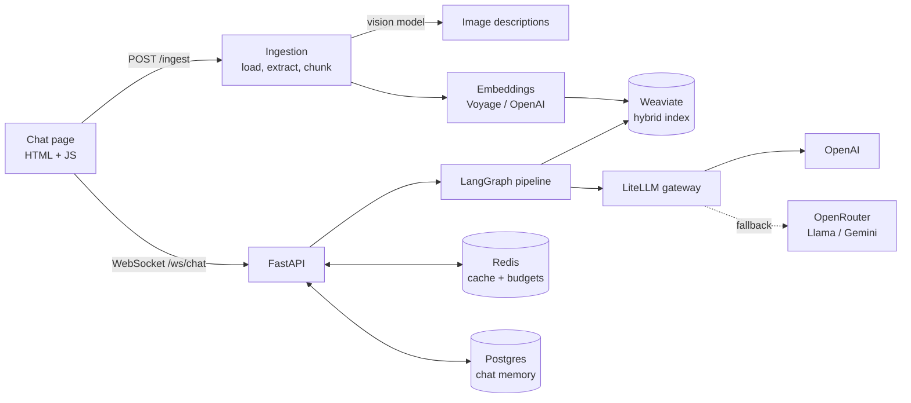
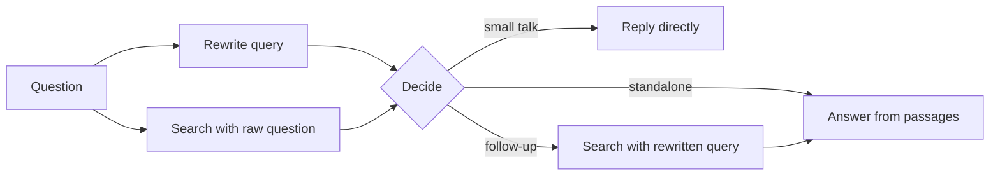

<div align="center">

# Enterprise RAG

**Ask questions about your own documents and get streamed answers grounded in them.**
Text, tables and images in your files are all searchable.

[](https://github.com/Varsha-1605/Question-Answering-Chatbot/actions/workflows/deploy.yml)


[Overview](#overview) · [Architecture](#architecture) · [Evaluation](#evaluation) · [Getting started](#getting-started) · [API](#api) · [Roadmap](#roadmap)

</div>


> [!NOTE]
> Live demo: _coming soon_ <!-- TODO: add the deployed URL -->

## Overview

You upload files (PDF, DOCX, TXT, CSV, XLSX). The app splits them into chunks, embeds them and stores them in Weaviate. You then ask questions in a chat page, and the answer streams back over a WebSocket. Answers come only from your documents, with file and page labels on each source passage.

What it does:

- **Smart routing.** Small talk is answered directly. Standalone questions reuse a search that already ran in parallel. Follow-up questions are rewritten using the chat history and searched again.
- **Hybrid search and reranking.** Keyword and vector search in Weaviate, then a cross-encoder reranks the results.
- **LLM gateway.** A LiteLLM router handles automatic retries, timeouts, fallback to Llama or Gemini through OpenRouter, per-model rate limits and usage-based load balancing. See [LLM gateway and reliability](#llm-gateway-and-reliability).
- **Redis caching.** It caches embeddings, answers to similar questions (semantic cache) and image descriptions. If Redis fails, the app treats it as a cache miss and keeps working.
- **Chat memory.** Chats are stored in Postgres, with auto-generated titles and renaming. The chat page keeps a chat list, waits for the server to be ready and shows clear error messages.
- **No duplicate work.** A file whose content has not changed is skipped on re-upload.
- **Guardrails.** Strict grounding, prompt-injection defense, scope control and multilingual answers.
- **Graceful failure.** Every step has a fallback, so one broken part doesn't take the chat down.
- **Observability.** LangSmith traces, per-question latency logs, cache stats and a startup warm-up.
- **Tested and evaluated.** 91 unit tests, plus a DeepEval suite of 10 evals with a baseline comparison.
- **CI/CD.** GitHub Actions runs the tests, builds a Docker image and deploys it to AWS EC2.

## Architecture



### How a question is answered



1. The query rewrite (a small, fast model) and a search with the raw question run at the same time.
2. The router picks one of three paths: reply, answer, or search again.
3. Search is hybrid (keyword + vector), then the top results are reranked by `cross-encoder/ms-marco-MiniLM-L-6-v2`.
4. The chat model streams the answer from numbered passages.

Before the graph runs, the semantic cache is checked. A cached answer is only reused for the same documents version, model, prompt and language.

### LLM gateway and reliability

Every LLM call goes through a [LiteLLM](https://docs.litellm.ai/) router, which handles failures and limits in one place. Rewrite and answer calls use separate model groups, because OpenAI limits are counted per model.

| Feature | How it works |
|---|---|
| **Automatic retries** | Timeouts, 5xx and "service unavailable" errors are retried once. Rate-limit errors are not retried; the call falls back instead. Query embeddings retry up to 2 times. |
| **Timeouts** | Each routed LLM call has a 20 s limit. Query embeddings have a 2 s limit, and Redis connect and read calls 0.2 s each, so a slow dependency can't stall an answer. Idle WebSocket connections close after 10 minutes. |
| **Automatic fallback** | If OpenAI fails or its budget is used up, the call moves to OpenRouter: answers go to Llama 3.3 70B, rewrites to Llama 3.1 8B, and then both to Gemini 2.5 Flash. |
| **Caching** | Redis caches query and document embeddings and answers to similar questions (semantic cache). OpenAI prompt caching serves about half of the input tokens. A circuit breaker skips Redis for 30 s after a failure, so the app keeps answering without the cache. |
| **Rate limiting** | Each OpenAI model has a per-minute budget of 4,000 requests (RPM) and 1.6M tokens (TPM), set at 80% of the account limit. Usage is counted in Redis, so the budget is shared across all app processes. The app also limits question length, upload size and the number of open WebSocket connections. |
| **Load balancing** | `usage-based-routing-v2` sends each call to the deployment with the most room left in its budget. With `LOAD_BALANCING_ENABLED`, the same OpenAI models are also reached through OpenRouter. In `overflow` mode the extra copies only take traffic when OpenAI is full; in `split` mode traffic is spread across both. |

### Answer quality and guardrails

- **Strict grounding.** The answer prompt only allows facts written in the retrieved passages. If the answer is not there, the model gives a fixed "I don't have that specific information…" reply and says what the documents do cover.
- **Partial and conflicting answers.** If the documents cover only part of a question, the model answers that part and says what is missing. If passages disagree, it reports each version.
- **Prompt-injection defense.** Documents, chat history and user messages are marked as data, not instructions, in every prompt (rewrite, answer, conversation and title). The model is told never to reveal its instructions.
- **Scope control.** General-knowledge questions and small talk go to a separate conversation prompt that never claims to know the documents. Unrelated tasks (essays, code, stories) are politely declined.
- **Search vs. rerank input.** Search uses the rewritten query, which has synonyms and resolved references, so it finds more. Reranking scores passages against the user's original question, so the order matches what was actually asked.
- **Multilingual.** Answers come in the language chosen in the chat page (English, Hindi, Spanish, French or German). The rewritten query stays in the user's language.
- **Chat history window.** Only the last 10 messages are sent to the model, to keep prompts small.

### Semantic cache rules

A cached answer is reused only when it is safe:

- Only standalone questions are cached. A follow-up such as "and what about it?" depends on the chat, so it always runs the full pipeline.
- Only answers built from retrieved passages are stored. Small talk and "not found" replies are never cached.
- Each entry is tied to the document set's version, the language, the chat model, the embedding model and a hash of the answer prompt. Uploading new content changes the version, so old answers are dropped automatically. Changing a model or the prompt does the same.

### Failure handling

Each step has a fallback, so one failing part degrades the answer instead of breaking it.

| If this fails | The app does this |
|---|---|
| Query rewrite | Searches with the original question |
| Raw-question search | Waits for the rewrite and searches with it |
| OpenAI (error or budget used up) | Falls back to Llama or Gemini through OpenRouter |
| Redis | Circuit breaker skips the cache for 30 s; answers still work |
| Weaviate connection drops | Reconnects automatically on the next call |
| Chat title (8 s limit) | Returns no title; the chat keeps its default name |
| Search or answer step | Sends a clear error code to the chat page instead of closing the connection |

Settings are checked at startup, for example overlap smaller than chunk size, keys present for the chosen provider, and Redis database 0 for the semantic cache. A bad config fails fast with a clear message.

### Ingestion details

- Files in one upload are processed in parallel. The size limit is checked while the file streams in, so an oversized file is rejected before it is fully stored.
- Text is cleaned (extra whitespace and stray characters removed), then split with a recursive splitter (1000 characters, 200 overlap).
- Each file gets a content hash. Re-uploading an unchanged file skips embedding, which saves time and cost.
- Each namespace is a Weaviate tenant, created automatically, so different document sets stay separate in one collection. Index and namespace names are sanitized.
- Files can also be loaded from a URL (for example a pre-signed S3 link). The loader blocks private and internal addresses and does not follow redirects, which protects against SSRF.

### Observability

- **LangSmith tracing** covers every request, with custom spans for hybrid search, reranking, file ingestion, chunking and Weaviate writes. Secrets such as pre-signed URLs are left out of traces.
- **Logs** record the rewritten query, routing decision, number of passages used, time to first token and total response time for every question. Production logs are JSON.
- **Cache stats** (hits, misses, errors and Redis memory) are logged every 5 minutes.
- **Warm-up:** at startup the app opens network connections (DNS, TCP, TLS) and loads the chat, rewrite and embedding models, Redis, Postgres and the reranker, all in parallel. `/ready` returns 503 until this finishes, so the first user doesn't pay the cold-start cost.

### Tech stack

| Layer | Tools |
|---|---|
| API | FastAPI, WebSocket, Uvicorn |
| Orchestration | LangGraph, LangChain |
| LLMs | OpenAI (`gpt-4o-mini`, `gpt-4.1-nano`), OpenRouter fallback via LiteLLM |
| Embeddings | OpenAI `text-embedding-3-small` |
| Vector store | Weaviate (hybrid search, one tenant per namespace) |
| Reranker | Sentence Transformers cross-encoder |
| Cache | Redis Stack (vector search for the semantic cache) |
| Memory | Postgres (LangGraph checkpointer) |
| Evaluation | DeepEval, LangSmith tracing |
| Deployment | Docker, Docker Compose, GitHub Actions, AWS EC2 |

## Evaluation

The evaluation suite runs 10 evals against 58 test questions (`goldens/`). It saves the results and compares them to a baseline, which gives a PASS, REVIEW or FAIL verdict.

Latest run (`gpt-4o-mini`, chunk size 1000, overlap 200, top-k 5, reranking on):

| Area | Metric | Result |
|---|---|---|
| Retrieval | Contextual recall | 97.5% |
| | Contextual precision | 95.0% |
| Generation | Faithfulness | 99.4% |
| | Answer relevancy | 94.9% |
| Full pipeline | Faithfulness | 92.5% |
| | Answer relevancy | 92.6% |
| | Contextual relevancy | 52.0% (needs work) |
| Answer quality | Correctness / completeness / style | 90.5% / 85.8% / 90.5% |
| Safety | Toxicity | 97.3% |
| | System / prompt leakage | 100% / 100% |
| | Scope adherence | 100% |
| | PII leakage | 100% |
| Operations | p95 end-to-end latency | 2.5 |
| | p95 time to first token | 1.5 |
| | Cost per query | ~$0.0004 |
| | Success rate | 100% |

Run it yourself:

```bash
uv run python -m evals.run_suit --baseline    # save baselines/baseline.json
uv run python -m evals.run_suit               # save baselines/candidate.json
uv run python -m evals.compare                # PASS / REVIEW / FAIL
```

Use `--only retriever,latency` to run a subset.

## Getting started

### Prerequisites

- Python 3.11+ and [uv](https://docs.astral.sh/uv/)
- Docker
- An OpenAI API key (optional: Voyage, OpenRouter and LangSmith keys)

### Run locally

```bash
git clone https://github.com/Varsha-1605/Question-Answering-Chatbot.git
cd Question-Answering-Chatbot

cp .env.example .env                          # add your API keys
docker compose up -d weaviate redis postgres
uv sync
uv run uvicorn main:app --reload
```

Open http://localhost:8000, upload a file from `data/`, and ask a question.

> [!TIP]
> On Windows with `POSTGRES_URL` set, start the app with
> `uv run uvicorn main:app --loop asyncio:SelectorEventLoop`.

### Tests

91 unit tests in `tests/` cover the API routes, WebSocket flow, LangGraph routing, reranker, semantic cache rules, chat titles, document loading, the ingestion pipeline, name sanitization and the follow-up question detector. External services are mocked, so the tests run without Weaviate or real API keys (CI uses a dummy `OPENAI_API_KEY`).

```bash
uv run pytest
```

### Command-line mode

You can try the pipeline without the web page:

```bash
uv run python -m ai_workflow.injestion.utils             # ingest data/transformer_paper.pdf
uv run python -m ai_workflow.retrieval.routes_with_graph # chat in the terminal, with timings
```

### Configuration

All settings are in [`.env.example`](.env.example). The main ones:

| Setting | Purpose |
|---|---|
| `OPENAI_CHAT_MODEL`, `REWRITE_MODEL` | Answer model and the faster query-rewrite model |
| `EMBEDDING_PROVIDER` | `voyage` or `openai` |
| `RERANKER_ENABLED`, `RERANK_CANDIDATES` | Cross-encoder reranking |
| `LLM_FALLBACK_ENABLED` | Route calls through the LiteLLM gateway with OpenRouter fallback |
| `ANSWER_MODEL_RPM_BUDGET`, `ANSWER_MODEL_TPM_BUDGET` (and `REWRITE_*`) | Per-minute request and token budgets for each OpenAI model |
| `LOAD_BALANCING_ENABLED`, `LOAD_BALANCING_MODE` | Add OpenRouter copies of the OpenAI models (`overflow` or `split`) |
| `FALLBACK_TIMEOUT_SECONDS` | Time limit for each routed LLM call (default 20 s) |
| `CACHE_ENABLED`, `SEMANTIC_CACHE_ENABLED` | Redis caching and answer reuse |
| `POSTGRES_URL` | Chat memory (leave unset to keep chats in the browser only) |

> [!IMPORTANT]
> Changing the embedding provider or dimensions needs a new index. Set a new `INDEX_NAME`, then re-ingest with `uv run python -m scripts.reindex data/`.

### Deployment

Every push to `main` runs [`deploy.yml`](.github/workflows/deploy.yml). It runs the tests, builds the Docker image, pushes it to Docker Hub, then starts the app, Weaviate, Redis and Postgres on an EC2 instance with [`docker-compose.prod.yml`](docker-compose.prod.yml).

The Docker image is a multi-stage `uv` build that runs as a non-root user. It has the reranker model built in, so the first start doesn't download it, and a health check on `/health`. The deploy step replaces the app container, waits for it to be healthy and fails the run if it isn't. It also clears old images first, so the server's disk doesn't fill up.

Required repository secrets: `DOCKER_USERNAME`, `DOCKER_PASSWORD`, `EC2_HOST`, `EC2_USER`, `EC2_SSH_KEY`, and `ENV_FILE` (the full `.env` content).

## API

| Endpoint | Purpose |
|---|---|
| `POST /ingest` | Upload files (multipart `files`) |
| `WS /ws/chat` | Send `{question, language?}`; receive `stream`, `end` and `error` messages. Add `?thread_id=` to resume a chat |
| `GET /chat/threads/{thread_id}/messages` | Messages of a stored chat |
| `POST /chat/title` | Short title for a chat's first question |
| `GET /health`, `GET /ready` | Liveness; readiness (warm-up done and Weaviate reachable) |

```bash
curl -F "files=@data/transformer_paper.pdf" localhost:8000/ingest
```

WebSocket error codes: `MAX_CONNECTIONS_REACHED`, `IDLE_TIMEOUT`, `INVALID_REQUEST`, `SEARCH_FAILED` and `ANSWER_FAILED`. Send `ping` to get `pong`. Without Postgres, the client sends `chat_context` (up to 50 messages) with each question.

> [!WARNING]
> There is no authentication. Add your own access control and rate limiting before exposing the app publicly.

## Project structure

```
ai_workflow/
├── injestion/        # upload route, loaders, chunking
├── retrieval/        # WebSocket route, LangGraph pipeline, prompts, reranker, chat memory
├── vector_db/        # Weaviate client, hybrid search, storage
├── cache/            # Redis client, embedding, semantic and image-description caches
└── utils.py          # LLM gateway and embedding factories
frontend/             # chat page (HTML, JS, CSS; Markdown and LaTeX rendering)
evals/, goldens/      # evaluation suite and test questions
tests/                # unit tests
```

## Roadmap

- [ ] Tool-calling agent where the LLM picks a tool: the RAG pipeline, web search (for recent or missing information), or a calculator
- [ ] Llama models switchable with OpenAI for query rewriting and answer generation
- [ ] Multimodal ingestion: extract tables and images from PDF and DOCX files, with a vision model describing charts, diagrams and scanned pages
- [ ] Authentication and per-user document spaces
