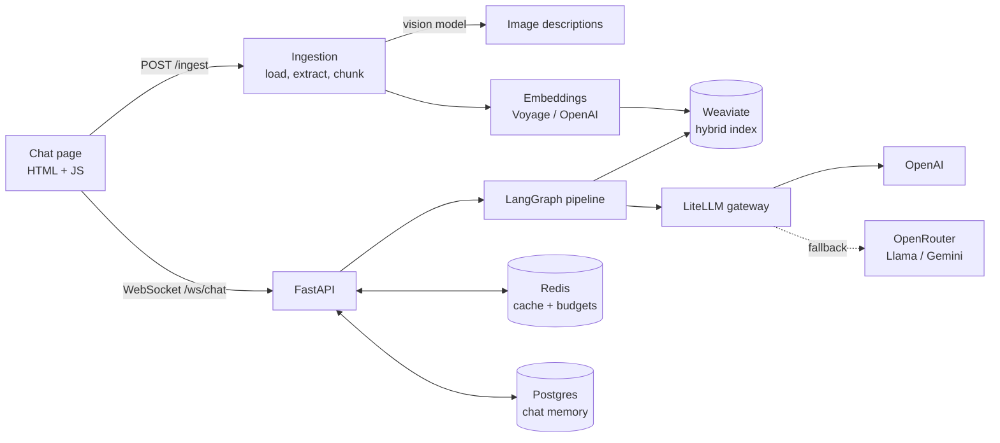
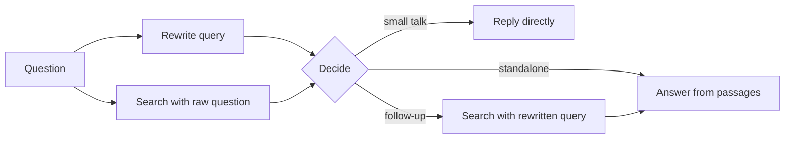

<div align="center">

# Multimodal Enterprise RAG

**Ask questions about your own documents and get streamed answers grounded in them.**
Text, tables and images in your files are all searchable.

[](https://github.com/Varsha-1605/Question-Answering-Chatbot/actions/workflows/deploy.yml)


[Overview](#overview) · [Architecture](#architecture) · [Evaluation](#evaluation) · [Getting started](#getting-started) · [API](#api) · [Roadmap](#roadmap)

</div>

<!-- TODO: replace with a screenshot or GIF of the chat page -->


> [!NOTE]
> Live demo: _coming soon_ <!-- TODO: add the deployed URL -->

## Overview

You upload files (PDF, DOCX, TXT, CSV, XLSX). The app splits them into chunks, embeds them and stores them in Weaviate. You then ask questions in a chat page, and the answer streams back over a WebSocket. Answers come only from your documents, with file and page labels on each source passage.

What it does:

- **Multimodal ingestion.** Text, tables and images in PDF and DOCX files become separate chunks. A vision model describes charts, diagrams and scanned pages. Tables keep their exact values.
- **Smart routing.** Small talk is answered directly. Standalone questions reuse a search that already ran in parallel. Follow-up questions are rewritten using the chat history and searched again.
- **Hybrid search and reranking.** Keyword and vector search in Weaviate, then a cross-encoder reranks the results.
- **LLM gateway with fallback.** A LiteLLM router sends calls to OpenAI first. If a call fails or the per-minute budget runs out, it falls back to Llama 3.3 / 3.1 or Gemini 2.5 Flash through OpenRouter.
- **Redis caching.** It caches embeddings, answers to similar questions (semantic cache) and image descriptions. If Redis fails, the app treats it as a cache miss and keeps working.
- **Chat memory.** Chats are stored in Postgres, with auto-generated titles and renaming.
- **Tested and evaluated.** 91 unit tests, plus a DeepEval suite of 10 evals with a baseline comparison.
- **CI/CD.** GitHub Actions runs the tests, builds a Docker image and deploys it to AWS EC2.

## Architecture



### How a question is answered



1. The query rewrite (a small, fast model) and a search with the raw question run at the same time.
2. The router picks one of three paths: reply, answer, or search again.
3. Search is hybrid (keyword + vector), then the top results are reranked by `cross-encoder/ms-marco-MiniLM-L-6-v2`.
4. The chat model streams the answer from numbered passages.

Before the graph runs, the semantic cache is checked. A cached answer is only reused for the same documents version, model, prompt and language.

### Tech stack

| Layer | Tools |
|---|---|
| API | FastAPI, WebSocket, Uvicorn |
| Orchestration | LangGraph, LangChain |
| LLMs | OpenAI (`gpt-4o-mini`, `gpt-4.1-nano`), OpenRouter fallback via LiteLLM |
| Embeddings | Voyage `voyage-multimodal-3.5` or OpenAI `text-embedding-3-small` |
| Vector store | Weaviate (hybrid search, one tenant per namespace) |
| Reranker | Sentence Transformers cross-encoder |
| Cache | Redis Stack (vector search for the semantic cache) |
| Memory | Postgres (LangGraph checkpointer) |
| Evaluation | DeepEval, LangSmith tracing |
| Deployment | Docker, Docker Compose, GitHub Actions, AWS EC2 |

## Evaluation

The evaluation suite runs 10 evals against 58 multimodal test questions (`goldens/`). It saves the results and compares them to a baseline, which gives a PASS, REVIEW or FAIL verdict.

Latest run (`gpt-4o-mini`, chunk size 1000, overlap 200, top-k 5, reranking on):

| Area | Metric | Result |
|---|---|---|
| Retrieval | Contextual recall | 94.7% |
| | Contextual precision | 85.1% |
| Generation | Faithfulness | 91.7% |
| | Answer relevancy | 95.7% |
| Full pipeline | Faithfulness | 98.8% |
| | Answer relevancy | 95.1% |
| Safety | Toxicity | 100% |
| | System / prompt leakage | 100% / 99.9% |
| | Scope adherence | 90.3% |
| | PII leakage | 56.7% (needs work) |
| Operations | p95 end-to-end latency | 3.4 s (missed SLO target) |
| | p95 time to first token | 2.5 s (missed SLO target) |
| | Cost per query | ~$0.0003 |
| | Success rate | 100% |

Run it yourself:

```bash
uv run python -m evals.run_suit --baseline    # save baselines/baseline.json
uv run python -m evals.run_suit               # save baselines/candidate.json
uv run python -m evals.compare                # PASS / REVIEW / FAIL
```

Use `--only retriever,latency` to run a subset.

## Getting started

### Prerequisites

- Python 3.11+ and [uv](https://docs.astral.sh/uv/)
- Docker
- An OpenAI API key (optional: Voyage, OpenRouter and LangSmith keys)

### Run locally

```bash
git clone https://github.com/Varsha-1605/Question-Answering-Chatbot.git
cd Question-Answering-Chatbot

cp .env.example .env                          # add your API keys
docker compose up -d weaviate redis postgres
uv sync
uv run uvicorn main:app --reload
```

Open http://localhost:8000, upload a file from `data/`, and ask a question.

> [!TIP]
> On Windows with `POSTGRES_URL` set, start the app with
> `uv run uvicorn main:app --loop asyncio:SelectorEventLoop`.

Run the tests:

```bash
uv run pytest
```

### Configuration

All settings are in [`.env.example`](.env.example). The main ones:

| Setting | Purpose |
|---|---|
| `OPENAI_CHAT_MODEL`, `REWRITE_MODEL` | Answer model and the faster query-rewrite model |
| `EMBEDDING_PROVIDER` | `voyage` (multimodal) or `openai` |
| `MULTIMODAL_ENABLED` | Extract tables and images from PDF/DOCX (off by default) |
| `RERANKER_ENABLED`, `RERANK_CANDIDATES` | Cross-encoder reranking |
| `LLM_FALLBACK_ENABLED` | Route calls through the LiteLLM gateway with OpenRouter fallback |
| `CACHE_ENABLED`, `SEMANTIC_CACHE_ENABLED` | Redis caching and answer reuse |
| `POSTGRES_URL` | Chat memory (leave unset to keep chats in the browser only) |

> [!IMPORTANT]
> Changing the embedding provider or dimensions needs a new index. Set a new `INDEX_NAME`, then re-ingest with `uv run python -m scripts.reindex data/`.

### Deployment

Every push to `main` runs [`deploy.yml`](.github/workflows/deploy.yml). It runs the tests, builds the Docker image, pushes it to Docker Hub, then starts the app, Weaviate, Redis and Postgres on an EC2 instance with [`docker-compose.prod.yml`](docker-compose.prod.yml).

Required repository secrets: `DOCKER_USERNAME`, `DOCKER_PASSWORD`, `EC2_HOST`, `EC2_USER`, `EC2_SSH_KEY`, and `ENV_FILE` (the full `.env` content).

## API

| Endpoint | Purpose |
|---|---|
| `POST /ingest` | Upload files (multipart `files`) |
| `WS /ws/chat` | Send `{question, language?}`; receive `stream`, `end` and `error` messages. Add `?thread_id=` to resume a chat |
| `GET /chat/threads/{thread_id}/messages` | Messages of a stored chat |
| `POST /chat/title` | Short title for a chat's first question |
| `GET /health`, `GET /ready` | Liveness; readiness (warm-up done and Weaviate reachable) |

```bash
curl -F "files=@data/transformer_paper.pdf" localhost:8000/ingest
```

> [!WARNING]
> There is no authentication. Add your own access control and rate limiting before exposing the app publicly.

## Project structure

```
app/
├── injestion/        # upload route, loaders, chunking; multimodal/ for PDF/DOCX images and tables
├── retrieval/        # WebSocket route, LangGraph pipeline, prompts, reranker, chat memory
├── vector_db/        # Weaviate client, hybrid search, storage
├── cache/            # Redis client, embedding, semantic and image-description caches
└── utils.py          # LLM gateway and embedding factories
frontend/             # chat page (HTML, JS, CSS; Markdown and LaTeX rendering)
evals/, goldens/      # evaluation suite and test questions
scripts/              # reindex.py, dump_chunks.py
tests/                # unit tests
```

## Roadmap

- [ ] Tool-calling agent where the LLM picks a tool: the RAG pipeline, web search (for recent or missing information), or a calculator
- [ ] Llama models switchable with OpenAI for query rewriting and answer generation
- [ ] Reduce latency to meet the p95 SLO targets
- [ ] Improve PII leakage protection
- [ ] Authentication and per-user document spaces
